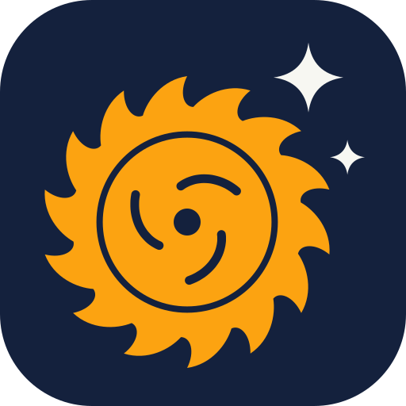

# document_collab_tool

A free, open-source workspace for humans and AI agents. Your pages and
databases are plain files in a git repository you own.

## Status

The first building block is in place: **`docsync`**, the sync engine
(`crates/docsync`). It keeps a workspace in sync between devices through any
git remote and resolves every conflict automatically, so users never see git.

- Design, conflict rules and the guarantees the tests check:
  [docs/sync-design.md](docs/sync-design.md)
- Run the tests: `cargo test`
- Run a longer randomized soak test:
  `DOCSYNC_SIM_SEEDS=300 DOCSYNC_SIM_STEPS=150 cargo test --release --test simulation`

Requires Rust 1.89+ and git 2.43+. The desktop app will bundle its own git.

## Next

The plan, in order, with what is done: [docs/roadmap.md](docs/roadmap.md).
