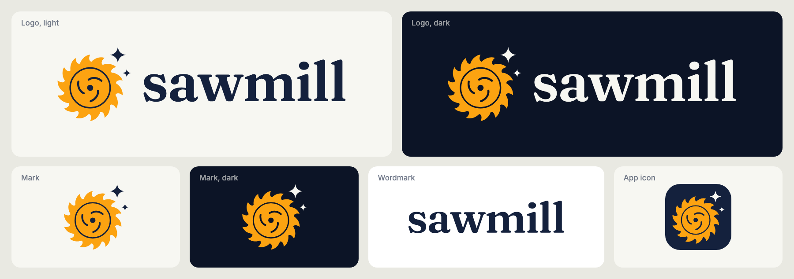
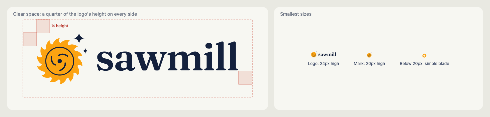
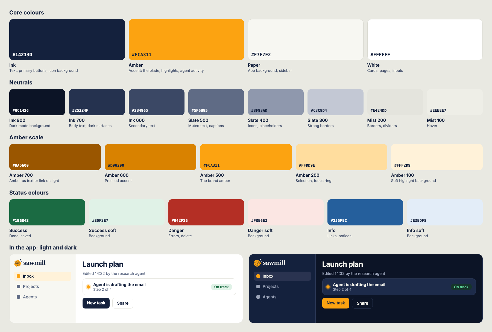
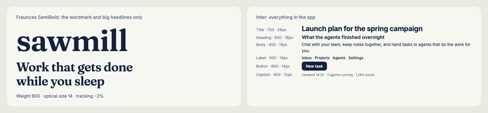
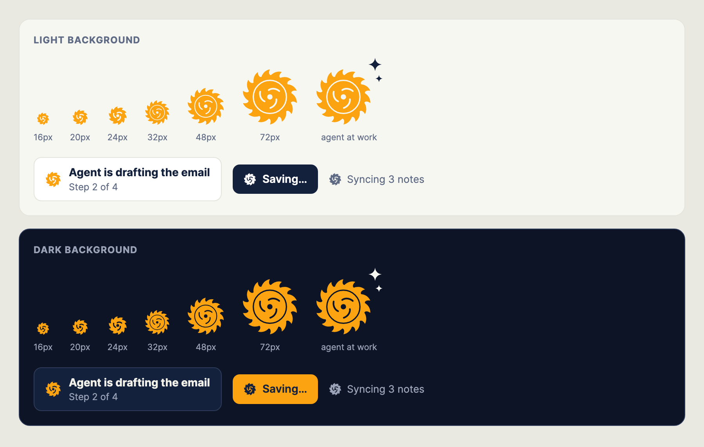

# Sawmill brand guidelines

Sawmill is the new name for the product this repository still calls Pagemesh.
This folder holds its logo, colours, fonts and the spinning saw that shows
work in progress.

**Status: designed, not yet applied.** The app has not been renamed and
nothing in it uses these files yet. [Using it in the app](#using-it-in-the-app)
lists what a switch would touch. The name was checked against US trademarks
and existing products; the EU, Benelux and UK registers still need a check by
hand at [TMview](https://www.tmdn.org/tmview/).

## What is in this folder

| Path | What it is |
|---|---|
| `logo/sawmill-logo-light.svg`, `-dark.svg` | The full logo: mark and wordmark |
| `logo/sawmill-mark-light.svg`, `-dark.svg` | The mark alone: blade and sparkles |
| `logo/sawmill-wordmark-light.svg`, `-dark.svg` | The word alone |
| `logo/sawmill-app-icon.svg` | The mark on an Ink rounded square |
| `logo/png/` | PNG copies with a transparent background, at twice the SVG size |
| `spinner/` | The spinning saw: two blades, the CSS and a demo page |
| `tokens.css` | Every colour and both fonts as CSS variables |
| `images/` | The pictures in this document |

The SVG files are the originals. "Light" and "dark" name the background a
file is meant for, so `sawmill-logo-dark.svg` is the one to put on a dark
background.

## The idea

A sawmill takes raw material in and sends finished work out, with machinery
doing the heavy part. The logo is a circular saw blade, for the work getting
done, with two sparkles beside it, for the agents doing it.

## Logo

### The parts

- **The mark** is an amber saw blade with fourteen teeth that all lean
  clockwise, a ring, a hub and three curved slots, and two four-pointed
  sparkles at its top right.
- **The wordmark** is "sawmill" in lower case, set in Fraunces SemiBold and
  converted to outlines, so the logo files do not need the font installed.
- **The logo** is the two together. The middle of the lower-case letters
  lines up with the hub of the blade.

### Which one to use

| Situation | Use |
|---|---|
| Anywhere there is room | The full logo |
| Small or square spaces: a sidebar header, an avatar, a favicon | The mark |
| Next to a mark that is already shown | The wordmark |
| Where the platform wants an icon shape: the Dock, the taskbar, an installer | The app icon |

The app icon is the only place the mark sits in a box.

### On light and dark backgrounds

- **Light:** the blade is Amber; the ring, hub, slots, sparkles and wordmark
  are Ink.
- **Dark:** the blade is Amber; the ring, hub and slots are cut out, so the
  background shows through; the sparkles and wordmark are Paper.

The ring and slots are what make the blade read as a saw and not as a sun.
Do not remove them from the logo.

### Clear space and smallest sizes

- Keep a quarter of the logo's height free on every side.
- The full logo is at least 24px high and the mark at least 20px.
- Below 20px, use the simple blade from `spinner/saw-spinner-small.svg`
  without sparkles. It has ten teeth and thicker slots, because fourteen
  teeth blur at that size.

### Do not

- Recolour the blade, or place it on amber or on a busy photograph.
- Put the mark in a box, circle or badge, except for the app icon.
- Set the word in another font, in capitals or with a capital S. In running
  text the name is written "Sawmill".
- Stretch, tilt, outline or add a shadow to any part.
- Move the sparkles, or use them without the blade.
- Rotate the logo. Only the progress indicator turns.

## Colour

### Core colours

| Name | Hex | Use |
|---|---|---|
| Ink | `#14213D` | Text, primary buttons, the app icon's background |
| Amber | `#FCA311` | The blade, highlights, agent activity |
| Paper | `#F7F7F2` | App background and sidebar |
| White | `#FFFFFF` | Cards, pages, inputs |

### Neutrals

| Name | Hex | Use |
|---|---|---|
| Ink 900 | `#0C1426` | Dark mode background |
| Ink 700 | `#25324F` | Body text, dark surfaces |
| Ink 600 | `#3B4865` | Secondary text |
| Slate 500 | `#5F6B85` | Muted text, captions |
| Slate 400 | `#8F98AD` | Icons, placeholders. Too faint for text. |
| Slate 300 | `#C3C8D4` | Strong borders |
| Mist 200 | `#E4E4DD` | Borders, dividers |
| Mist 100 | `#EEEEE7` | Hover |

The dark neutrals are tinted towards Ink and the light ones towards Paper, so
text is cool and surfaces are warm.

### Amber scale

| Name | Hex | Use |
|---|---|---|
| Amber 700 | `#9A5600` | Amber as text or a link on a light background |
| Amber 600 | `#D98200` | Pressed accent |
| Amber 500 | `#FCA311` | The brand amber |
| Amber 200 | `#FFDD9E` | Selection, focus ring |
| Amber 100 | `#FFF2D9` | Soft highlight background |

### Status colours

| Name | On light | Soft background | On dark | Soft background |
|---|---|---|---|---|
| Success | `#1B6B43` | `#E0F2E7` | `#5FD39A` | `#16352B` |
| Danger | `#B42F25` | `#FBE6E3` | `#FF8A7A` | `#3A1E1F` |
| Info | `#255F9C` | `#E3EDF8` | `#7FB4F0` | `#17294A` |

A warning uses Amber 700 on Amber 100.

### Dark mode

| Role | Hex |
|---|---|
| Background | `#0C1426` |
| Sidebar | `#14213D` |
| Raised surface, hover | `#1D2B4A` |
| Selected | `#2A3350` |
| Border | `#2E3B5A` |
| Text | `#F1F1EA` |
| Muted text | `#9AA3B8` |

### Rules

- **Amber is an accent, not a text colour.** On Paper its contrast is 1.9 to
  1, far too faint to read. For amber-coloured text or links on a light
  background, use Amber 700.
- **Primary buttons** are Ink with white text on a light background and
  Amber with Ink text on a dark one.
- **Use amber sparingly:** the selected item, an agent at work, the focus
  ring. Spread everywhere, it starts to look like a warning.
- **Text on Amber is always Ink,** never white.

### Contrast

Body text needs a contrast of at least 4.5 to 1. These pairs were measured:

| Text | Background | Contrast |
|---|---|---|
| Ink | Paper | 14.9 |
| Ink | White | 16.0 |
| Ink | Amber | 7.9 |
| Ink 600 | Paper | 8.5 |
| Slate 500 | Paper | 5.0 |
| Slate 500 | White | 5.4 |
| Amber 700 | Paper | 5.3 |
| Amber 700 | Amber 100 | 5.1 |
| Success | Success soft | 5.6 |
| Danger | Danger soft | 5.2 |
| Info | Info soft | 5.6 |
| Dark text `#F1F1EA` | Dark background | 16.2 |
| Dark text `#F1F1EA` | Raised surface | 12.4 |
| Dark muted `#9AA3B8` | Dark background | 7.3 |
| Dark muted `#9AA3B8` | Raised surface | 5.6 |
| Amber | Dark background | 9.1 |

## Typography

| Font | Where |
|---|---|
| **Fraunces** SemiBold | The wordmark, and large headlines on a website or in a presentation |
| **Inter** | Everything in the app |

- **Fraunces** in the wordmark is weight 600 at optical size 14, with
  tracking of −2%. Use the same settings for headlines. It is never used for
  body text or inside the app.
- **Inter** already ships with the app. Titles are weight 700, headings and
  buttons 600, labels 500 and body text 400.
- The fonts a person can choose for their own pages (serif, rounded,
  monospace) are a setting in the app, not part of the brand, and stay as
  they are.

Both fonts are free to use and to ship with the app under the SIL Open Font
License.

## The spinning saw

The blade turns to show that something is in progress. It replaces a generic
spinner and makes waiting look like work getting done.

Open `spinner/demo.html` in a browser to see it move.

- **Two blades.** Use `saw-spinner.svg` at 32px and larger, and
  `saw-spinner-small.svg` below that.
- **Direction and speed.** Clockwise, the way the teeth lean, at a steady
  1.4 seconds per turn.
- **Colour.** Amber by default. Inside a button or muted text the blade
  takes the colour of the text.
- **Sparkles are for agents.** When an agent is working, show the two
  sparkles beside the blade; they stay in place and twinkle. Ordinary
  loading and saving use the blade alone.
- **Less motion.** For people who have asked their system for reduced
  motion, the blade turns once in 8 seconds and the sparkles are still.

The three slots are what make the turning visible. A plain toothed circle
looks almost still when it rotates, so do not simplify them away.

## Using it in the app

None of this has been done. A switch would touch these places:

- **Name.** The app, its identifier (`dev.pagemesh.app`) and the
  documentation still say Pagemesh.
- **App icon.** `assets/icon.svg` is the Pagemesh icon, and the top-level
  README shows it. `logo/sawmill-app-icon.svg` would replace it. The
  development build has its own orange icon, drawn from
  `assets/icon-dev.svg`, and needs a variant of its own.
- **Logo in the app.** `Logo` in `apps/desktop/src/Graphics.tsx` draws the
  Pagemesh logo and would draw the mark instead.
- **Colours.** `apps/desktop/src/app.css` sets the app's colours as
  variables. The table below is a starting point.
- **Spinner.** The two blades become a component that uses the rules in
  `spinner/spinner.css`.
- **Fonts.** Nothing to do: the app is already in Inter, and the wordmark is
  an image.

| App variable | Light | Dark |
|---|---|---|
| `--bg` | White `#FFFFFF` | `#0C1426` |
| `--sidebar-bg` | Paper `#F7F7F2` | `#14213D` |
| `--text` | Ink `#14213D` | `#F1F1EA` |
| `--muted` | Slate 500 `#5F6B85` | `#9AA3B8` |
| `--border` | Mist 200 `#E4E4DD` | `#2E3B5A` |
| `--hover` | Mist 100 `#EEEEE7` | `#1D2B4A` |
| `--selected` | Amber 100 `#FFF2D9` | `#2A3350` |
| `--accent` | Ink `#14213D` | Amber `#FCA311` |
| `--accent-text` | White `#FFFFFF` | Ink `#14213D` |
| `--accent-soft` | Amber 100 `#FFF2D9` | `#2A3350` |
| `--ok`, `--green` | Success `#1B6B43` | `#5FD39A` |
| `--danger`, `--error` | Danger `#B42F25` | `#FF8A7A` |
| `--blue` | Info `#255F9C` | `#7FB4F0` |
| `--warm`, `--warn` | Amber 700 `#9A5600` | Amber `#FCA311` |

Two things need a decision before the colours go in:

- **Links.** Where the app uses `--accent` for links, Ink would look the
  same as the text around it. Those places need Info or Amber 700.
- **The accent setting.** The app lets a person choose an accent colour, and
  violet is the default. Either the brand colours become the default and the
  other choices stay, or the setting goes.
